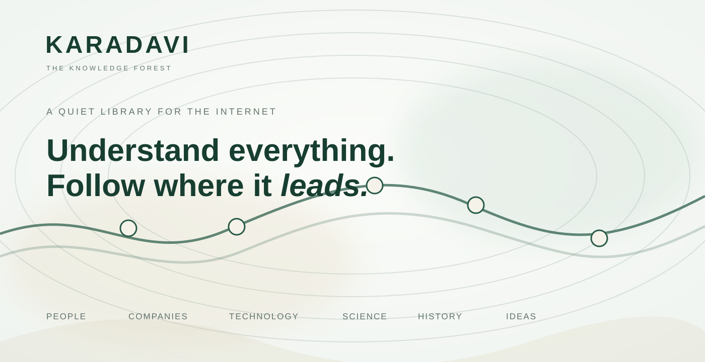
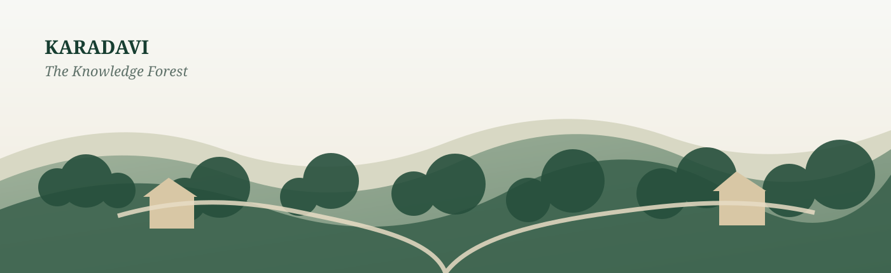

<div align="center">



<br />

[**ENTER KARADAVI.COM →**](https://www.karadavi.com)

</div>

---

# THE KNOWLEDGE FOREST

**KARADAVI is an open knowledge platform: a continuously evolving institution for exploring the world's knowledge as an interconnected whole.**

People, organizations, technologies, discoveries, places, events, ideas, natural systems and cultures do not exist in isolation. Their identities, histories, claims and relationships form a much larger picture.

KARADAVI is being built to make that picture explorable.

> **Every page is a starting point. Every connection leads somewhere.**

<div align="center">

### PEOPLE · COMPANIES · TECHNOLOGY · SCIENCE · SPACE
### CONCEPTS · HISTORY · PLACES · NATURE & EARTH · SOCIETY & CULTURE

</div>

---

## THE PROBLEM

The internet has made information abundant, but abundance has not made knowledge coherent.

Information is distributed across publications, databases, archives, registries, research repositories and other independent sources. The same entity may appear under different names. Claims can conflict. Context gets lost when information is copied. Sources change, and once-useful facts become stale.

Search can find pages. A conventional article can explain one subject. Neither necessarily preserves the evidence, identity and relationships needed to understand how that subject fits into the wider world.

KARADAVI's premise is that **knowledge should be represented as a connected, evidence-aware system—not merely accumulated as isolated pages.**

## THE KNOWLEDGE INSTITUTION

KARADAVI's long-term mission is broad: to help people understand meaningful, identifiable knowledge across the world. That is a north star for an extensible institution, not a claim that every subject will be covered at launch.

The platform is designed to:

- identify and represent entities consistently;
- connect entities through meaningful, typed relationships;
- distinguish observations, claims, evidence and interpretation;
- preserve source attribution and transformation history;
- represent conflicting, incomplete, ambiguous and stale information;
- make knowledge readable to people and structured for software;
- discover gaps and propose updates as the world changes.

The goal is not a universal truth machine or an automatically generated encyclopedia. It is a maintained knowledge resource whose basis and limitations can be inspected.

## TEN KNOWLEDGE TRAILS

The initial discovery experience uses ten broad trails:

| Trail | Scope |
|:--|:--|
| **People** | People, their work, ideas, decisions and lives |
| **Companies** | Companies, institutions, organizations and ecosystems |
| **Technology** | Technologies, systems, tools, platforms and inventions |
| **Science** | Discoveries, disciplines, theories and experiments |
| **Space** | Celestial objects, missions, exploration and discoveries |
| **Concepts** | Ideas and concepts connecting disciplines |
| **History** | Events, periods, movements and historical context |
| **Places** | Countries, cities, regions and meaningful locations |
| **Nature & Earth** | Species, ecosystems, geography, climate and natural systems |
| **Society & Culture** | Communities, institutions, traditions, media and culture |

These trails are discovery surfaces, not the limits of the knowledge model. KARADAVI's underlying ontology must remain extensible enough to represent new entity types and relationships without forcing reality into ten fixed buckets.

A trail can cross every other trail. A person can connect to a company, a technology, a place, a scientific idea and a historical event.

## THE KNOWLEDGE MODEL

KARADAVI is entity-centered and knowledge-graph-first. A page is one human-readable view of a deeper connected model.

At a conceptual level:

```text
Entity
  ├── Claims
  │     ├── Evidence
  │     ├── Sources
  │     ├── Provenance
  │     ├── Authority / context
  │     └── Uncertainty / conflicts
  ├── Relationships ──> Other entities
  ├── Explanations and representations
  └── Revisions and history
```

An entity is not the same as a claim about it. A claim is not the same as its evidence. A source is not automatically authoritative for every question. A published representation is not proof that uncertainty has disappeared.

These distinctions allow knowledge to be corrected and expanded without erasing how it was established.

**[Explore the public knowledge model →](docs/knowledge-model.md)**

## HOW KNOWLEDGE EVOLVES

KARADAVI is intended to be continuously maintained, not populated once and left untouched.

Its conceptual lifecycle is:

```text
Discover sources and research leads
              ↓
      Retrieve / observe material
              ↓
       Extract and normalize
              ↓
     Resolve canonical identity
              ↓
  Build claims, evidence and provenance
              ↓
  Reconcile sources and surface conflicts
              ↓
      Prepare research / drafts
              ↓
       HUMAN EDITORIAL REVIEW
              ↓
          APPROVAL
              ↓
       Publish connected knowledge
              ↓
 Monitor change and propose updates
              └───────────↺
```

Research and automation can discover, extract, compare, normalize, classify, draft and propose updates. They cannot independently approve or publish.

> **AI never publishes.**

This is a permanent editorial invariant, not a temporary limitation. Human editors retain publication authority, including for autonomous discovery and update workflows.

**[Read the editorial model →](docs/editorial-model.md)**

## EVIDENCE, PROVENANCE AND TRUST

KARADAVI aims to preserve the path from source material to published representation.

It distinguishes:

- **Identity:** what subject is being represented, including unresolved ambiguity;
- **Claims:** what is being asserted and about whom or what;
- **Evidence:** what supports, weakens or contextualizes a claim;
- **Provenance:** where information came from and how it was transformed;
- **Authority:** the standing a source has for a particular claim and context;
- **Uncertainty:** what is unknown, incomplete, stale, disputed or contradicted;
- **Evaluation:** how available evidence and context are interpreted.

Sources can disagree. Claims can change. A knowledge system should preserve those conditions rather than silently flattening them into a confident-looking answer.

## OPEN KNOWLEDGE, PUBLIC RESEARCH, PRIVATE IMPLEMENTATION

KARADAVI is intended as an open knowledge platform: the public knowledge experience and appropriate research outputs are meant to be accessible and useful beyond the project itself.

The public repository, [`aruntito/enterkaradavi`](https://github.com/aruntito/enterkaradavi), contains the public research and specification layer: conceptual models, research questions, experimental schemas, reference examples and documentation.

The canonical production application is maintained separately in the private repository, [`aruntito/karadavi`](https://github.com/aruntito/karadavi). Its production application code, private datasets, deployment configuration, internal infrastructure and operational tooling are not published in this repository.

This distinction is deliberate. **Open access to knowledge does not require publishing every part of the software implementation.** The public research repository is MIT-licensed, but that licence does not apply to the separate private product repository.

See [the public/private boundary](docs/public-private-boundary.md) for the exact scope.

## PUBLIC RESEARCH

This repository makes the ideas behind KARADAVI inspectable and open to discussion. It explores:

- extensible knowledge ontology and entity identity;
- claim and relationship semantics;
- evidence and provenance across transformations;
- source authority in context;
- uncertainty, contradiction and knowledge change;
- entity resolution and reconciliation;
- human editorial approval as part of knowledge provenance;
- machine-readable representations and interoperability.

The schemas are experimental. They are not presented as finalized standards. Research should produce evidence, documented limitations, failed hypotheses or explicit specification decisions.

**[Research program →](docs/research-program.md)** · **[Specifications →](specs/)** · **[Research notes →](research/)** · **[Examples →](examples/)**

## PROJECT MATURITY

KARADAVI's vision is intentionally larger than its initial release. The public research repository tracks the maturity of its own models and experiments; it does not claim that the entire knowledge institution or all autonomous workflows are already complete.

The product roadmap distinguishes implemented foundations from work still being built and longer-term ambitions. See [project status](docs/project-status.md) and [roadmap](ROADMAP.md).

## PRINCIPLES

**CONNECTED KNOWLEDGE** — relationships are first-class, not decorative links.

**EXTENSIBLE ONTOLOGY** — trails help discovery; they do not constrain what can be represented.

**EVIDENCE BEFORE ASSERTION** — important claims should retain inspectable support.

**PROVENANCE THROUGH TRANSFORMATION** — preserve where information came from and how it changed.

**UNCERTAINTY IS INFORMATION** — unknown, ambiguous, incomplete, stale and disputed are meaningful states.

**CONTEXTUAL AUTHORITY** — authority depends on the claim, domain, time and context.

**HUMAN PUBLICATION AUTHORITY** — AI can assist; humans approve publication.

**CONTINUOUS STEWARDSHIP** — knowledge should be revisited as sources and the world change.

---

## REPOSITORY MAP

```text
enterkaradavi/
├── README.md
├── docs/       Public vision, models, architecture and editorial rules
├── research/   Open research questions and investigations
├── specs/      Experimental machine-readable schemas
├── examples/   Synthetic reference examples
└── assets/     KARADAVI visual identity
```

This repository is the public research and specification companion to the private product. It is not a source-code mirror.

---

<div align="center">



### KARADAVI

**A knowledge forest for the world.**

*Every page is a starting point. Every connection leads somewhere.*

<br />

[**ENTER THE FOREST →**](https://www.karadavi.com)

</div>
